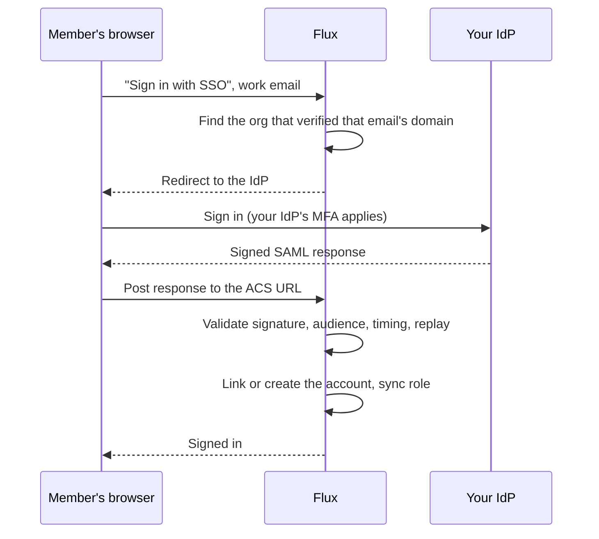

# Single sign-on (SAML)

> **Edition:** Enterprise. On Community and Pro, the **Single sign-on** tab shows an upgrade prompt and the sign-in page is unchanged.

Single sign-on lets members sign in with your identity provider (IdP), such as Okta, Microsoft Entra ID (Azure AD), Google Workspace, or any SAML 2.0 IdP. Flux creates an account the first time someone signs in, keeps their role in step with your IdP groups, and can require SSO for your whole organization.

Most organizations add SSO after they've been using Flux with passwords for a while, so this guide covers that path. Nothing changes for your members until you turn on enforcement in the final step.

## Contents

- [How it works](#how-it-works)
- [Before you start](#before-you-start)
- [Turn on SSO for an existing organization](#turn-on-sso-for-an-existing-organization)
- [Identity provider setup](#identity-provider-setup)
- [Roles and provisioning](#roles-and-provisioning)
- [Enforcement and break-glass access](#enforcement-and-break-glass-access)
- [Two-factor authentication](#two-factor-authentication)
- [Changing hosts, certificates or providers](#changing-hosts-certificates-or-providers)
- [Troubleshooting](#troubleshooting)

## How it works

Flux only starts sign-ins itself (SP-initiated). If someone clicks the Flux tile on your IdP's dashboard (IdP-initiated), they're sent to the Flux sign-in page to start from there.

## Before you start

- You need to be an **owner** of the organization.
- Flux must know its public address. Set `PHX_HOST` (and the port and scheme, if you use a reverse proxy) so the URLs Flux shows match what your IdP will post to. See the [operator manual](operator_manual.md#required-environment-variables).
- You need to be able to add a DNS TXT record for each email domain you want to use.

## Turn on SSO for an existing organization

1. **Connect your IdP.** Go to **System Settings → Single sign-on**. Create a SAML app in your IdP using the details in the next section. Paste the IdP's metadata XML into Flux, then click **Set up SSO**. Flux now shows its own *Service provider details*. If your IdP needs them, copy them back into its app.
2. **Verify your domains.** Add each email domain your members use, such as `example.com`. Publish the TXT record Flux shows (name `_flux-sso.example.com`), then click **Verify**. Only addresses at verified domains can use SSO. Each domain can be verified by one organization only, so another organization on the same deployment can't claim your users.
3. **Let members link.** Once a domain is verified, the sign-in page shows **Sign in with SSO**. An existing member's first SSO sign-in links to the account they already have; their pipelines, API keys, password and role stay as they are. Track progress under **Readiness & enforcement**.
4. **Require SSO** when you're ready. See [Enforcement](#enforcement-and-break-glass-access).

You can stop after step 3 and leave SSO optional for as long as you like.

## Identity provider setup

Every IdP asks for the same three values, which Flux shows under **Service provider details**:

| Flux label | Okta | Microsoft Entra ID | Google Workspace |
|---|---|---|---|
| ACS URL | Single sign-on URL | Reply URL | ACS URL |
| Entity ID | Audience URI (SP Entity ID) | Identifier (Entity ID) | Entity ID |
| SP metadata | (upload not needed) | Upload metadata file (optional) | (not used) |

Set the **NameID** to the user's email address. Send these attributes, and enter their names in Flux if they differ from what your IdP uses:

| Flux field | Typical attribute name |
|---|---|
| Email | `email` (Okta), `http://schemas.xmlsoap.org/ws/2005/05/identity/claims/emailaddress` (Entra ID). If left blank, Flux uses the NameID. |
| First name / Last name | `firstName` / `lastName` |
| Groups | `groups`. In Okta, add a *Group Attribute Statement*. In Entra ID, add a *group claim*. |

Responses must be **signed** with SHA-256. Flux accepts a signature on the response, the assertion, or both. Encrypted assertions aren't supported yet, so leave assertion encryption off.

Attribute values, including group names, can't contain `<`, `&` or `"`. Flux refuses responses that do, because those characters could let a response be altered without breaking its signature. If a group is named something like `R&D`, send a different value for it, such as the group ID.

## Roles and provisioning

- **New users.** If someone signs in with SSO and has no Flux account, Flux creates one at their verified email address and adds them to your organization. In team mode, it also adds them to the **team new users join**. They get the role of the first group mapping that matches, or the default role if none does.
- **Existing members.** Their first SSO sign-in links to their existing account. Their role changes only if a group mapping matches.
- **Every sign-in.** If a group mapping matches, the member's role is updated, so changes in your IdP flow through. If none matches, the role is left alone. A role you set by hand in Flux sticks unless your IdP says otherwise.
- **Owners.** SSO never makes anyone an owner, and never changes an owner's role.
- **Disabled members.** A member you've disabled in Flux stays disabled. SSO won't re-enable them.

Write mappings one per line as `Group name = role`, where role is `admin`, `member` or `viewer`. The first match wins.

Flux links a person to your IdP by the IdP's subject identifier. If their email changes in your IdP later, they still sign in to the same Flux account.

## Enforcement and break-glass access

Turning on **Require SSO** does three things:

- Members other than owners can no longer sign in with a password or an email link. Flux tells them to use SSO, and only after they've entered a correct password, so it doesn't reveal who is SSO-only.
- **Members other than owners are signed out straight away**, so enforcement applies immediately rather than as old sessions expire.
- Members who belong to several organizations on the same deployment must use SSO if any of those organizations requires it.

What it doesn't change:

- **Owners keep password sign-in.** This is your break-glass if your IdP is down or misconfigured. Make sure at least one owner has a password and two-factor authentication.
- **Passwords aren't deleted.** Turning enforcement off restores password sign-in at once.
- **API keys keep working.** They're for machines, not people.

If your Enterprise license lapses, SSO is switched off and enforcement stops, so members can use passwords and email links again. Members who were created through SSO have no password. They can sign in with an email link.

## Two-factor authentication

When someone signs in with SSO, your IdP handles two-factor authentication. Flux doesn't ask for its own code, even if the member has set one up or you've turned on **Require MFA** under Security. Configure MFA in your IdP.

SSO sessions don't offer "keep me logged in". When the session ends, members sign in through your IdP again. That's usually a single click while their IdP session is still active.

## Changing hosts, certificates or providers

- **New host or domain.** The Entity ID is fixed when SSO is set up, so it doesn't change. The ACS URL does follow the host, though. If it changes, Flux shows a warning; update the ACS URL in your IdP.
- **Rotating the IdP's signing certificate.** Paste the IdP's updated metadata. If it lists both the old and new certificates, Flux trusts both until you paste metadata that drops the old one.
- **Switching IdPs.** Paste the new IdP's metadata. Members linked to the old IdP link again on their first sign-in with the new one.
- **Removing SSO.** **Remove** deletes the IdP connection, its domains and all member links, and ends enforcement.

## Troubleshooting

| Symptom | Likely cause |
|---|---|
| "Single sign-on isn't set up for that email address" | The email's domain isn't verified, or it's verified by a different organization. |
| **Verify** says the record wasn't found | DNS hasn't propagated yet, or the record was added at the wrong name. It must be exactly `_flux-sso.<domain>`. |
| "Single sign-on didn't complete" | Check **Audit log** for `sso_login_failed`; its *reason* field says why. Common reasons: wrong ACS URL or Entity ID in the IdP, a clock off by more than two minutes, a response more than five minutes old, an unsigned or SHA-1-signed response, an attribute value containing `<`, `&` or `"`, an email outside your verified domains, or a disabled member. |
| Members bounce back to the sign-in page after the IdP | Usually blocked or third-party-restricted cookies, or a different host than the one the sign-in started on. Start at Flux's public URL. |
| On-premises: Flux can't verify a domain | Flux checks DNS from the server. In an isolated network, the server needs to resolve public TXT records. |
